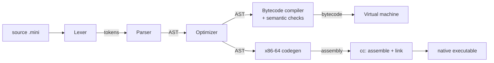

# minic: a compiler for MiniLang, written in C++17

[](https://github.com/YOUR_USERNAME/minic/actions/workflows/ci.yml)

`minic` is a compiler for **MiniLang**, a small dynamically typed scripting language I designed. It has **two backends**:

- a **bytecode compiler + virtual machine**, which runs every MiniLang program and is faster than CPython 3.13 on the included benchmarks
- a **native x86-64 code generator**, which emits assembly that links into a real Linux executable and runs **7–14x faster than the VM**

It's written from scratch in modern C++17 with **no dependencies**: about 4,300 lines across the compiler, runtime and tests.

```text
$ cat fib.mini
fn fib(n) {
    if (n < 2) return n;
    return fib(n - 1) + fib(n - 2);
}
print fib(32);

$ ./minic run fib.mini              # bytecode VM
2178309
$ ./minic build fib.mini -o fib     # native x86-64 executable
$ ./fib
2178309
```

## Highlights

| Area | What's implemented |
|---|---|
| **Front end** | Hand-written lexer and recursive-descent parser with precedence climbing; clang-style diagnostics with line, column and a caret; **error recovery** that reports many syntax errors in one run without cascades |
| **Semantic analysis** | Name resolution with block scoping, globals vs locals, compile-time arity checks, `break`/`continue`/`return` placement, forward references to functions |
| **Optimizer** | AST passes: constant folding (ints, strings, comparisons, short-circuit logic), constant-branch elimination, dead-code removal. It's proven safe by differential tests (`-O0` and `-O1` must agree) |
| **Bytecode VM** | 32-opcode stack machine; **computed-goto dispatch**; **static stack-depth analysis** so the stack is checked once per call, not on every push; intrusive non-atomic reference counting; runtime errors with **full stack traces** |
| **Native backend** | x86-64 System V code generation (AT&T syntax): register argument passing, 16-byte stack alignment tracking, **compare-and-branch fusion**, direct operand loads, division-by-zero trap with the source line |
| **Tooling** | `run`, `build`, `dump` (disassembler), `ast`, `tokens`, and an incremental **REPL** with rollback of failed inputs |
| **Testing** | 51 unit tests, golden tests for every example at both optimization levels, **VM-vs-native differential tests**, error-message tests. CI covers GCC and Clang, Make and CMake, plus ASan/UBSan |

## Quick start

```bash
make            # builds ./minic  (or: cmake -S . -B build && cmake --build build)
make test       # unit + integration tests
make bench      # benchmarks
make sanitize   # full test suite under AddressSanitizer + UndefinedBehaviorSanitizer
```

You need a C++17 compiler (GCC 9+ or Clang 10+). `minic build` additionally needs x86-64 Linux and `cc` to assemble and link.

```text
usage: minic [command] [options] <file.mini>

commands:
  run      compile to bytecode and execute on the VM (default)
  build    compile to a native x86-64 executable (Linux; needs cc)
  dump     print the compiled bytecode
  ast      print the syntax tree
  tokens   print the token stream
  repl     start an interactive session (also: minic with no arguments)

options:
  -O0          disable the optimizer
  -o <file>    output path for build
  -S           build: emit assembly (<output>.s) and stop
```

## The language

```js
// Variables: integers, strings, arrays, nil
let name = "MiniLang";
let primes = [2, 3, 5, 7];
push(primes, 11);
print name, "has", len(primes), "primes:", primes;   // MiniLang has 5 primes: [2, 3, 5, 7, 11]

// Control flow
for (let i = 0; i < 10; i += 1) {
    if (i % 2 == 0) continue;
    if (i > 7) break;
    print i;
}

// Functions: recursion, forward references, globals visible inside
fn gcd(a, b) {
    while (b != 0) { let t = b; b = a % b; a = t; }
    return a;
}
print gcd(1071, 462);   // 21
```

Built-ins: `len`, `push`, `pop`, `str`, `int`, `input`, `clock`, `assert`, `type`, `abs`, `array`. The full reference, including the grammar, is in [docs/LANGUAGE.md](docs/LANGUAGE.md).

## Diagnostics

Errors point at the exact column. The parser recovers and keeps going, so you see every mistake at once:

```text
$ ./minic broken.mini
broken.mini:1:11: error: expected ';' after variable declaration, found 'print'
 1 | let x = 10
   |           ^
broken.mini:3:8: error: expected ')' after parameters, found '{'
 3 | fn f(a {
   |        ^
broken.mini:6:14: error: expected an expression, found ';'
 6 | let y = (1 + ;
   |              ^
3 errors generated.
```

Runtime errors come with a stack trace:

```text
$ ./minic run crash.mini
crash.mini:1: runtime error: index 5 out of range for length 3
    at inner() line 1
    at outer() line 2
    at <script> line 3
```

## Architecture



```text
src/
  common/     diagnostics: source locations, error rendering
  frontend/   lexer, AST (+ S-expression printer), recursive-descent parser
  middle/     AST optimizer
  backend/    values, bytecode + disassembler, compiler, VM, built-ins, x86-64 codegen
  driver/     pipeline, REPL, command-line interface
tests/
  unit/       unit tests (dependency-free test framework)
  golden/     expected output for every example
  errors/     programs that must fail with a specific message
examples/     10 sample programs (sorting, N-Queens, Game of Life, sieve, RPN calculator, ...)
benchmarks/   MiniLang benchmarks + Python equivalents
docs/         language reference and design notes
```

See [docs/ARCHITECTURE.md](docs/ARCHITECTURE.md) for the design of each stage: the instruction set, calling convention, stack-depth analysis, native register usage and the testing strategy.

### What the stages produce

For `fn square(x) { return x * x; } ... print "total:", total * (2 + 3);`:

<table>
<tr><th>Bytecode (<code>minic dump</code>)</th><th>x86-64 (<code>minic build -S</code>)</th></tr>
<tr><td>

```text
== square  (arity 1, locals 1) ==
00000   1 LOAD      0
00002   | LOAD      0
00004   | MUL
00005   | RET
...
00041   | CONST     4  ; 5   <- 2 + 3 folded
00043   | MUL
00044   | PRINT     2
```

</td><td>

```asm
mini_square:
    push %rbp
    mov %rsp, %rbp
    sub $16, %rsp
    mov %rdi, -8(%rbp)
    mov -8(%rbp), %rax
    mov -8(%rbp), %rcx
    imul %rcx, %rax
    leave
    ret
```

</td></tr>
</table>

## Performance

Best of 3 runs, in seconds, on a 2-vCPU Linux x86-64 VM with GCC 13 at `-O2` and Python 3.13. Run `make bench` to reproduce on your machine.

| Benchmark | What it stresses | VM | Native | CPython 3.13 |
|---|---|---:|---:|---:|
| `fib(32)` | ~7M recursive calls | 0.15 | **0.022** | 0.26 |
| nested loops (9M iterations) | arithmetic, branches | 0.47 | **0.033** | 0.85 |
| sieve to 5,000,000 | array reads and writes | 0.82 | n/a¹ | 1.00 |

¹ The native backend compiles the integer subset of the language. Programs with arrays, string operations or built-ins are rejected with a clear message and run on the VM instead.

How the VM got there. The first version took 0.47 s for `fib(32)`; three changes made it about 3x faster:
1. **Computed-goto dispatch** and keeping `ip`, `sp` and the frame base in registers instead of reloading them from the frame each instruction.
2. **Static stack-depth analysis.** The compiler computes each function's maximum operand depth, so the VM checks for room once per call and pushes without bounds checks.
3. **Intrusive, non-atomic reference counting.** This replaced `std::shared_ptr`, whose atomic refcount updates dominated array-heavy code.

## Testing

```text
$ make test
51 passed, 0 failed (51 unit tests)
golden tests (VM, -O1 and -O0) ...
native backend (x86-64 output must match the VM) ...
error tests ...
36 passed, 0 failed, 0 skipped
```

- **Unit tests** cover each stage separately: the lexer (tokens, columns, escapes, errors), the parser (precedence, desugaring, recovery), the optimizer (folding, safety), semantic errors, VM semantics and runtime errors, incremental compilation, and native code-generation patterns.
- **Golden tests**: every program in `examples/` must reproduce its expected output exactly, with and without the optimizer.
- **Differential testing**: native executables must produce byte-identical output to the VM.
- **Sanitizers**: the whole suite runs under ASan and UBSan in CI. That caught a real out-of-bounds read in the native backend during development.

## Limitations and next steps

- The native backend covers the integer subset. Next: a small C runtime for strings and arrays, so every program can compile natively.
- No floating-point numbers, maps or closures yet.
- Reference counting can't free cyclic arrays. A tracing cycle collector would fix that.
- Possible optimizations: register allocation in the native backend, bytecode superinstructions, and inlining small functions.

## License

MIT. See [LICENSE](LICENSE).
